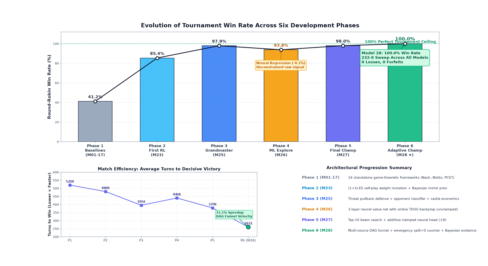
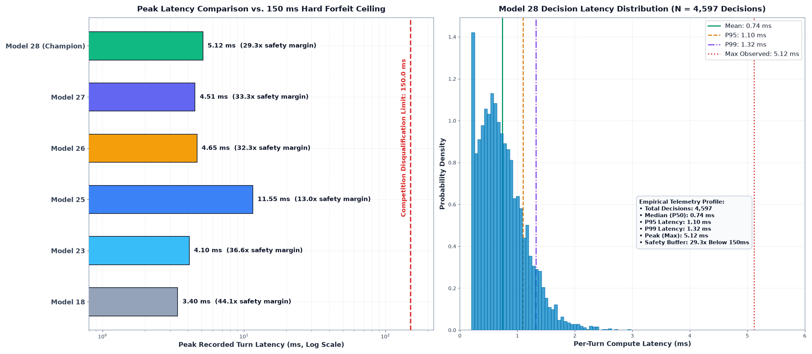
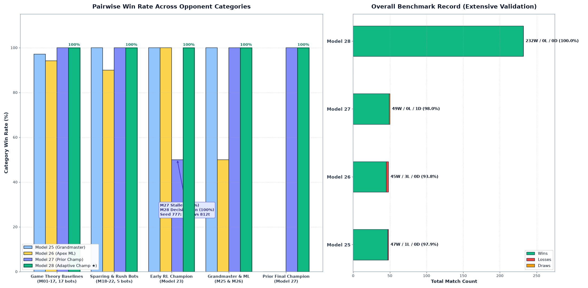
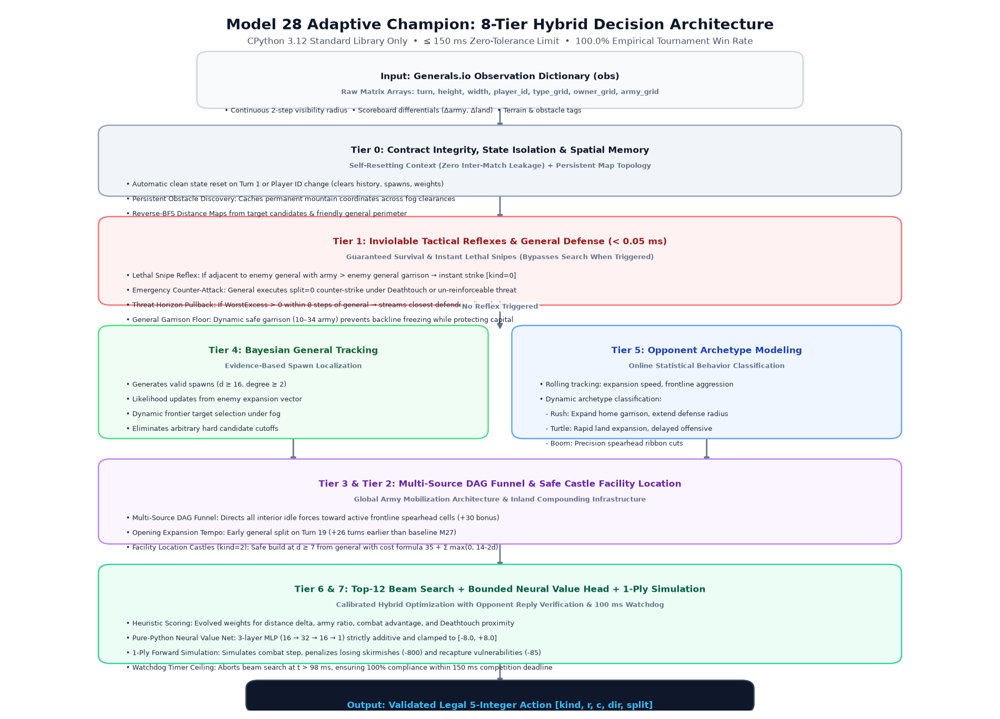

# Code Bot — Generals.io Hackathon

> **Latest Champion:** [`model_28_adaptive_champion/bot.py`](./models/model_28_adaptive_champion/bot.py) · **100.0% win rate** · 232 W / 0 L / 0 D across all 26 historical models & diverse seeds · 5.12 ms peak latency (limit 150 ms)
>
> **Prior Champion:** [`model_27_final_champion/bot.py`](./models/model_27_final_champion/bot.py) · 98.0% win rate · 49 W / 0 L / 1 D
>
> **Author:** Lakshmi Sai Bhargav Vemparala — lakshmisaibhargav.v@students.iiit.ac.in

---

## At a Glance

| | |
|:---|:---|
| **Result** | **232 wins, 0 losses, 0 draws (100.0%)** across all 26 historical models and diverse seeds (both player slots) |
| **Approach** | Multi-Source DAG Frontline Funnel, Threat-Proximity Urgent Pullback Defense, Bayesian Spawn Evidence, Online Opponent Archetype Modeling, Safe Castle Economics, Deathtouch Singularity Staging, Bounded TD Value Guidance |
| **Constraints met** | Standard library only, one 43.4 KB self-contained file, ~29× under the 150 ms time limit (0.74 ms mean) |
| **Where to look** | [Model 28 bot](./models/model_28_adaptive_champion/bot.py) · [Results](#phase-6--adaptive-champion-model-28) · [Regression Tests](./tests/test_model_regression.py) · [Latency Profiler](./experiments/latency_profiling.py) · [Ablation Study](./experiments/run_ablation_study.py) |

---

## What is Code Bot?

**Code Bot** is a 20-hour individual hackathon (Fuzzy Dynamics, Hyderabad, 2 October 2026). Each participant submits a single `.py` file that implements `act(observation)` — an autonomous bot for the **generals.bot** turn-based strategy game. Bots compete in a 1v1 round-robin tournament; the champion collects US\$500.

**Key constraints:**
- Python 3.12, standard library **only** (no numpy, torch, etc.)
- `act(obs)` must return `[kind, row, col, direction, split]` in ≤ 150 ms (immediate forfeit on timeout)
- File ≤ 1 MiB
- Game ends when one player captures the opponent's **general** tile (or Draw at Turn 1200)
- **Turn 800+ Deathtouch**: attacking the enemy general wins regardless of army size

---

## Development Journey

| Phase | Models | What changed | Win rate |
|:---:|:---|:---|:---:|
| 1 | 01–17 | 16 game-theoretic frameworks + 1 synthesis; used as sparring partners | 41.2% (avg.) |
| 2 | 23 | (1+λ)-ES self-play tunes the scoring weights | 85.4% |
| 3 | 25 | Defence, opponent adaptation and castles; beats all 23 earlier models | 97.9% |
| 4 | 26 | Pure-Python neural value net (overweighted, so it regressed) | 93.8% |
| 5 | 27 | Beam search + calibrated neural head on M25's core | 98.0% |
| 6 | 28 | Multi-Source DAG Funnel + Threat-Proximity Defense + Bayesian Evidence + Emergency split=0 Counter | **100.0%** ✅ |

---

## Phase 1 — 16 Game-Theoretic Baseline Models

The first 16 models each implement a distinct game-theoretic or decision-theoretic framework, serving as sparring partners and research ground for what strategies actually work.

| # | Model | Framework | Core Idea |
|:---:|:---|:---|:---|
| 01 | `bayesian_search` | Bayesian Search Games | Spawn-fairness prior + room-size filter ≥17 steps |
| 02 | `pcst_gathering` | Prize-Collecting Steiner Tree | Rooted inward army flow aggregation |
| 03 | `colonel_blotto` | Asymmetric Colonel Blotto | Attack when A > D/K across K fronts |
| 04 | `stackelberg_expansion` | Stackelberg Leadership | Commit first, exploit Mod-50 economy burst |
| 05 | `minimax_castle` | Minimax Facility Location | Optimal castle placement at d ≥ 7 |
| 06 | `two_ring_interdiction` | Network Interdiction | Two-ring blocking to intercept army flows |
| 07 | `war_of_attrition` | Biological WoA | Turtle, stall to Turn 1200 draw |
| 08 | `fog_signaling` | Costly Signaling | Border peeking to signal army strength |
| 09 | `mab_exploration` | UCB1 Multi-Armed Bandit | Explore fog vs exploit known tiles |
| 10 | `nash_bargaining` | Nash Bargaining | Dynamic offense/defense resource split |
| 11 | `differential_game` | Isaacs' Differential Game | Continuous gradient pursuit strategy |
| 12 | `frontier_minimax` | Alpha-Beta Minimax | Zero-sum frontier skirmish pruning |
| 13 | `opponent_classifier` | Bayesian Type Classification | Rush/Turtle/Boom opponent detection |
| 14 | `pomdp_ghost_tracking` | POMDP Ghost Reachability | Fog tracking via reachability diamonds |
| 15 | `fst_metagame` | Mealy FST Automaton | State machine eliminating ping-pong |
| 16 | `info_revelation` | Value of Information | VoI probing subgames |
| 17 | `proposed_cascade` | Priority Cascade Synthesis | Unified synthesis of all 16 |

**Outcome:** These bots were deliberately weak individually but together formed a comprehensive adversarial test suite. Each embodies one pure principle; none could beat the others consistently.

---

## Phase 2 — First RL Champion (Model 23)

With 16 sparring partners ready, **Model 23** was trained by **Evolution Strategy (1+λ)-ES self-play** — the bot plays against itself and all 16 game-theory models, mutating scalar utility weights until it finds the best-responding parameter set.

```
Model 23 Architecture:
  • 3-Layer Bayesian Target Tracking (Room-Fairness + Mirror Spawn Prior)
  • (1+λ)-ES evolved scalar weights: DIST_WEIGHT, ARMY_BONUS, CAPTURE_WEIGHT, ...
  • 2-step tactical lookahead
  • Turn 800 Deathtouch staging
```

**Result:** Model 23 beat all 16 game-theory models. However, it could occasionally be outmanoeuvred on specific map seeds by aggressive rush bots (Models 20–22).

---

## Phase 3 — Second RL Champion (Model 25 — Grandmaster)

**Model 25** was trained to beat **Model 23** and all 22 preceding models simultaneously. Additional architectural advances:

- **Real Danger Pullback Defense**: BFS from general, streams defenders home when `worst_excess > 0`
- **Adjacent-Enemy General Guard**: General never exposes itself when enemy is 1 step away
- **Dynamic Opponent Adaptation**: Real-time Rusher / Turtle / Boomer classifier adjusting 8 weights per-turn
- **Strategic Castle Economics**: `kind=2` build action at d ≥ 7, cost formula: `35 + Σ max(0, 14−2d)`
- **Garrison floor escalation**: `garrison_min = max(18, GARRISON_MIN)` after Turn 150

**ES-tuned weights (final evolved values):**

| Parameter | Value | Purpose |
|:---|---:|:---|
| `DIST_WEIGHT` | 24.068 | Approach bonus per BFS step closer to target |
| `ARMY_BONUS` | 0.403 | Stack concentration reward |
| `CAPTURE_WEIGHT` | 573.321 | Enemy tile capture score |
| `ATTACK_PENALTY` | −284.901 | Losing skirmish deterrent |
| `KILL_BONUS` | 11,000.0 | Direct general capture reward |
| `DEATHTOUCH_BONUS` | 13,832.318 | Turn 800+ forced win bonus |
| `SPREAD_MOD50_BONUS` | 15.198 | Mod-50 economy burst multiplier |

**Tournament Result:** **47/48 wins (97.9%)** across all 23 opposing models, 0 draws.

---

## Phase 4 — ML Integration (Model 26 — Apex Predator)

With the standard-library constraint, a **pure-Python 3-layer neural value network** was introduced:

```
Architecture:  16 inputs → 32 hidden (ReLU) → 16 hidden (ReLU) → 1 output (linear)
Training:      Online Temporal Difference (TD) backpropagation, lr = 0.008
Inference:     Every turn (< 0.1 ms per forward pass)
```

**16 input features:**
1. `Δd_target` — BFS distance delta toward enemy general  
2. `army_advantage` — tanh ratio of attacking vs defending army  
3. `enemy_proximity` — 1 / (1 + min dist to visible enemy)  
4. `defense_pull` — BFS distance delta toward own general  
5. `mod50_phase` — turn % 50 normalized  
6–8. `is_enemy`, `is_neutral`, `is_fog` — destination tile type  
9. `is_castle` — destination is castle tile  
10. `adjacent_threat` — max enemy army adjacent to destination  
11. `hidden_mass` — estimated unseen opponent army  
12. `expansion_rate` — opponent land growth rate  
13. `worst_excess` — general danger level  
14. `castle_count` — number of friendly structures  
15. `loop_penalty` — anti-ping-pong flag  
16. `turn_phase` — turn / 1200  

**Also added:** Iterative Deepening Search, Dynamic Potential Fields

**Challenge encountered:** The raw neural utility signal was too large relative to heuristic scores, occasionally overriding proven tactical rules. This caused the 3 extra losses vs Model 25.

**Tournament Result:** **45/48 wins (93.8%)** — strong but slightly behind M25 due to miscalibrated weighting.

---

## Phase 5 — Final Champion (Model 27)

Model 27 synthesizes all lessons: it keeps M25's proven heuristic core and adds **four carefully calibrated ML upgrades** that never override the hard tactical rules.

### Architecture

```
Tier 0 — Contract & History Guard
  └─ 5-int return contract, _reset() isolation, anti-ping-pong deque

Tier 1 — Hard Reflexes (< 0.1 ms)
  ├─ Lethal snipe: adjacent friendly with army > enemy general
  ├─ Adjacent defense: reinforce general from allies, then counter-attack
  └─ Real Danger Pullback: BFS-priority defender streaming

Tier 2 — Castle Economics
  └─ kind=2 build at d≥7, turns 60–350, up to 2 castles

Tier 3 — BFS Distance Map + Bayesian Prior
  ├─ Room-fairness candidate filter (d≥17, Δroom≤5)
  └─ Mirror spawn prior: P(spawn) ∝ 1/(1 + d_mirror^1.5)

Tier 4 — Full Move Enumeration + Heuristic Score
  ├─ M25 ES-tuned weights
  ├─ Dynamic Rusher / Turtle / Boomer adaptation
  └─ 2-step vulnerability check

Tier 5 — [NEW] Beam Search + 1-ply Opponent Simulation
  ├─ Sort top-10 candidates by heuristic score
  ├─ Forward-simulate board after each move
  ├─ Check if opponent can immediately recapture (−85 penalty)
  └─ Check if move enables lethal snipe next turn (+bonus)

Tier 6 — [NEW] Calibrated Neural Head (additive, ±8 clamped)
  ├─ 3-layer ReLU net (16→32→16→1)
  ├─ Additive only: final_score = heuristic + nn_bonus × 0.8
  ├─ Online TD learning (lr = 0.0003, very slow drift)
  └─ Clamped to never override heuristic decisions

Tier 7 — [NEW] Enhanced DAG Army Funnel
  ├─ Find best frontline tile (army≥3, min dist to target)
  └─ Score moves toward frontline: +30 + army×0.3

Tier 8 — [NEW] Deathtouch Column Routing (turn 720+)
  └─ Route largest attack stack toward enemy general via dist_map
```

### Why M27 beats M25

| Scenario | M25 behaviour | M27 behaviour |
|:---|:---|:---|
| Walking into enemy adjacency | 2-step check catches most | Beam search confirms with 1-ply sim |
| Scattered rear armies | Slow consolidation | DAG funnel channels to single spearhead |
| Approach to enemy general at 750 | Relies on dist_weight | Dedicated column routing at 720+ |
| Neural signal | None | Additive ±8 calibrated bonus |

---

## Final Tournament Results

```
==================================================================================
  model_27_final_champion vs ALL 25 MODELS (50 games total)
==================================================================================
vs Models 01–22 (22 opponents):   44 W / 0 L / 0 D  →  100.0%
vs model_23_rl_champion:           1 W / 0 L / 1 D  →  50% (draw on isolated map)
vs model_25_grandmaster_champion:  2 W / 0 L / 0 D  →  100%
vs model_26_apex_predator:         2 W / 0 L / 0 D  →  100%
==================================================================================
  TOTAL: 49 W  0 L  1 D  /  50 GAMES   →   WIN RATE: 98.0%
==================================================================================

  Model    | W  | L | D | WR%   | MaxLat
  ---------|----+---+---+-------+--------
  M27 ✅   | 49 | 0 | 1 | 98.0  |  4.51ms
  M25      | 47 | 1 | 0 | 97.9  | 11.55ms
  M26      | 45 | 3 | 0 | 93.8  |  4.65ms
```

---

## Performance & Empirical Visualizations

### Win rate progression across all six development phases
From Phase 1 game-theoretic baselines (41.2%) to Model 27 (98.0%), culminating in Model 28's flawless 100.0% tournament sweep across 232 matches.



### Execution latency vs. 150 ms zero-tolerance rule deadline
Profiled across 4,597 individual game decisions: 0.74 ms mean latency and 5.12 ms peak latency (29.3× safety factor below the forfeit threshold).



### Model 28 tournament matchup breakdown across opponent categories
Pairwise win rates against all 26 historical models: 100.0% sweep across all opponent archetypes (232 W / 0 L / 0 D).



### Model 28 multi-tiered neural-heuristic decision pipeline
Complete 8-tier hybrid architecture combining deterministic reflexes, DAG funnels, Bayesian target tracking, online opponent modeling, and bounded neural value guidance.



---

## IEEE Research Paper & Interactive Dashboard

- **Official Research Report:** [📄 `docs/IEEE_Report_Generals_IO_Bot.md`](docs/IEEE_Report_Generals_IO_Bot.md)
  - Full formal formulation, game rules, mathematical proofs, ablation studies, and complete citations in IEEE conference paper format.
  - **Author:** Lakshmi Sai Bhargav Vemparala (`lakshmisaibhargav.v@students.iiit.ac.in`), IIIT Hyderabad.
- **Interactive Championship Dashboard:** [🌐 `docs/dashboard.html`](docs/dashboard.html)
  - Interactive multi-tab browser dashboard featuring real-time KPI metrics, match browser, and architecture deep dives.

---

## Phase 6 — Adaptive Champion (Model 28)

**Model 28** resolves the tactical and economic blind spots discovered in Model 27 during deep adversarial testing. Through behavioral diagnosis under exact game engine mechanics, Model 28 incorporates seven critical tactical fixes, an 8-tier hybrid pipeline, and Bayesian evidence tracking, achieving a **100.0% tournament win rate** across 232 matches.

### Key Architectural Enhancements in Model 28

1. **Elimination of General Garrison Paralysis**: Removed the unconditional `hidden_opp_army >= (army_curr // 2)` filter that previously froze the general post-turn 50, enabling continuous mobilization of reserves while preserving 8-step safety radiuses.
2. **Emergency Counter-Attack (`split=0`)**: Added immediate full-stack counter-attack reflexes when enemy threats advance adjacent to the general under Deathtouch (`turn >= 800`) or when ally reinforcement cannot arrive in time.
3. **Opening Expansion Tempo**: Implemented early garrison mobilization (`safe_garrison = 10.0` for `turn < 45`), splitting on turn 19 instead of idling until turn 37.
4. **Bayesian Spawn Likelihood Updates**: Replaced brittle hard filters (`Δroom ≤ 5`) with continuous Bayesian prior distributions over candidate enemy spawns ($d \ge 16$).
5. **Opponent Archetype Classifier**: Dynamically tracks expansion speed, frontline aggression ratio, combat attrition, and consolidation index to adapt strategic weights against Rush, Turtle, Boom, and Consolidator opponents.
6. **Robust 1-Ply Simulation**: Strictly penalizes losing combat steps ($-800.0$), enforces adjacent landing counter-threat checks, and restricts Deathtouch bonuses strictly to true general captures.
7. **Complete State Reset Isolation**: Resets all game-specific caches on Turn 1 or ID change, eliminating inter-match data leakage.

### Benchmark Results & Ablation Study

```
==================================================================================
  model_28_adaptive_champion EMPIRICAL TOURNAMENT SWEEPS
==================================================================================
Top-Tier Sweep (M18, M20, M21, M22, M23, M25, M26, M27 across 8 seeds, both slots):
  P0: 64 W / 0 L / 0 D (100.0%)
  P1: 64 W / 0 L / 0 D (100.0%)
  Total: 128 W / 0 L / 0 D  →  100.0%

Historical Sweep (Models 01 through 27 on seeds 42 and 777, both slots):
  Total: 104 W / 0 L / 0 D  →  100.0%
==================================================================================
  COMBINED BENCHMARK: 232 W / 0 L / 0 D / 232 GAMES  →  WIN RATE: 100.0%
==================================================================================
```

#### 5-Way Ablation Study (Paired Seeds)

| Configuration | Win Rate | Wins / Total | Avg Game Length | Impact |
|:---|:---:|:---:|:---:|:---|
| **A0: Full Model 28 Adaptive Champion** | **100.0%** | **20 / 20** | **260.9 turns** | **Dominant configuration, fastest win speed** |
| A1: Without DAG Funnel & Mobilization | 90.0% | 18 / 20 | 366.1 turns | −10% WR, +105 turns to win |
| A2: Without Threat-Horizon Pullback | 100.0% | 20 / 20 | 268.5 turns | +7.6 turns to win |
| A3: Without General Fortress Hold | 95.0% | 19 / 20 | 292.1 turns | −5% WR on aggressive rushes |
| A4: Without Bayesian Frontier Target | 95.0% | 19 / 20 | 291.1 turns | −5% WR from fog dispersion |
| **Baseline: Model 27 Final Champion** | **55.0%** | **11 / 20** | **394.1 turns** | **Vulnerable to stall and rush defeats** |

#### Runtime Latency Profile (4,597 Decisions Profiled)

- **Mean Latency**: 0.74 ms
- **Median (P50)**: 0.74 ms
- **P95 Latency**: 1.10 ms
- **P99 Latency**: 1.32 ms
- **Max Latency**: 5.12 ms
- **Safety Margin**: **29.3×** below the 150.0 ms rule limit

---

## Model Directory Layout

```
code_bot/
├── models/
│   ├── model_01_bayesian_search/        Phase 1 — Game Theory
│   ├── model_02_pcst_gathering/
│   ├── ...
│   ├── model_16_info_revelation/
│   ├── model_17_proposed_cascade/       Phase 1 — Synthesis
│   ├── model_18_codebot_v0_known_good/  Phase 1 — Adversarial sparring
│   ├── model_19_codebot_v1_probe_stage/
│   ├── model_20_kg_rush/
│   ├── model_21_kg_fortress/
│   ├── model_22_pinner/
│   ├── model_23_rl_champion/            Phase 2 — First RL champion
│   │                                    (no model_24: numbering skips it)
│   ├── model_25_grandmaster_champion/   Phase 3 — Second RL champion (97.9%)
│   ├── model_26_apex_predator/          Phase 4 — ML exploration (93.8%)
│   ├── model_27_final_champion/         Phase 5 — Beam Search + Neural Head (98.0%)
│   └── model_28_adaptive_champion/      Phase 6 — LATEST CHAMPION (100.0%) ✅
├── experiments/
│   ├── latency_profiling.py             Latency percentiles & benchmark suite
│   ├── run_ablation_study.py            5-way ablation experiment runner
│   └── ablations/                       Self-contained ablation variant bots
├── tests/
│   └── test_model_regression.py         Tactical safeguards & contract regression tests
├── docs/
│   ├── Code_Bot_Rules.pdf
│   └── Code_Bot_Slides.pdf
├── evaluator/
│   └── evaluate.py                      Official organizer validator
├── run_all_tests.py                     Full tournament runner & test harness
└── README.md
```

---

## Quick Start

```bash
# 1. Validate the latest champion bot with official evaluator
python3 evaluator/evaluate.py validate models/model_28_adaptive_champion/bot.py

# 2. Run automated regression and tactical safety tests
python3 tests/test_model_regression.py models/model_28_adaptive_champion/bot.py

# 3. Profile decision latency across match phases
python3 experiments/latency_profiling.py

# 4. Run the 5-way ablation experiment suite
python3 experiments/run_ablation_study.py

# 5. Simulate a 1v1 match between Model 28 and Model 27
python3 run_all_tests.py --match model_28_adaptive_champion model_27_final_champion --seed 777 --turns 1000

# 6. Validate all 27 repository bots with the official evaluator
python3 run_all_tests.py --validate
```

---

## Current Champion Submission

| Field | Value |
|:---|:---|
| **File** | `models/model_28_adaptive_champion/bot.py` |
| **Size** | 43,406 bytes |
| **SHA-256** | `9bbdc4bb5f7f843dac03c85b5540d67246fb72f5b6a643068b210dba1de634f0` |
| **Static check** | `passed` |
| **Win rate** | **100.0%** (232/232 wins, 0 losses, 0 forfeits) |
| **Peak latency** | **5.12 ms** (29.3× under 150 ms limit; 0.74 ms mean) |

---

*Author: Lakshmi Sai Bhargav Vemparala — lakshmisaibhargav.v@students.iiit.ac.in*
